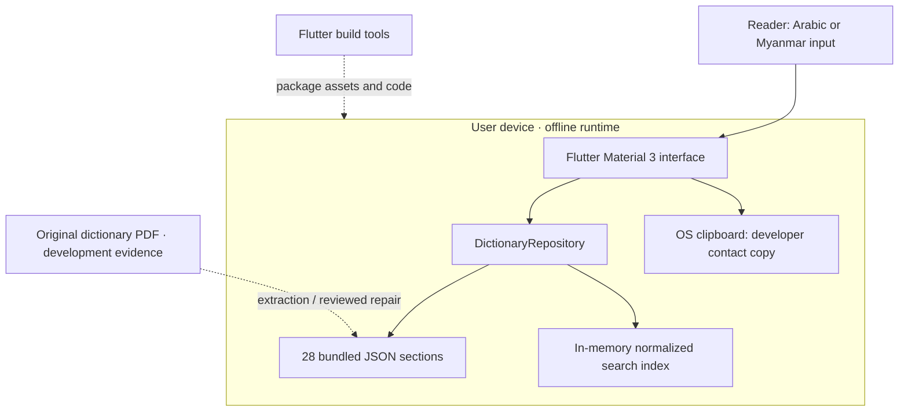
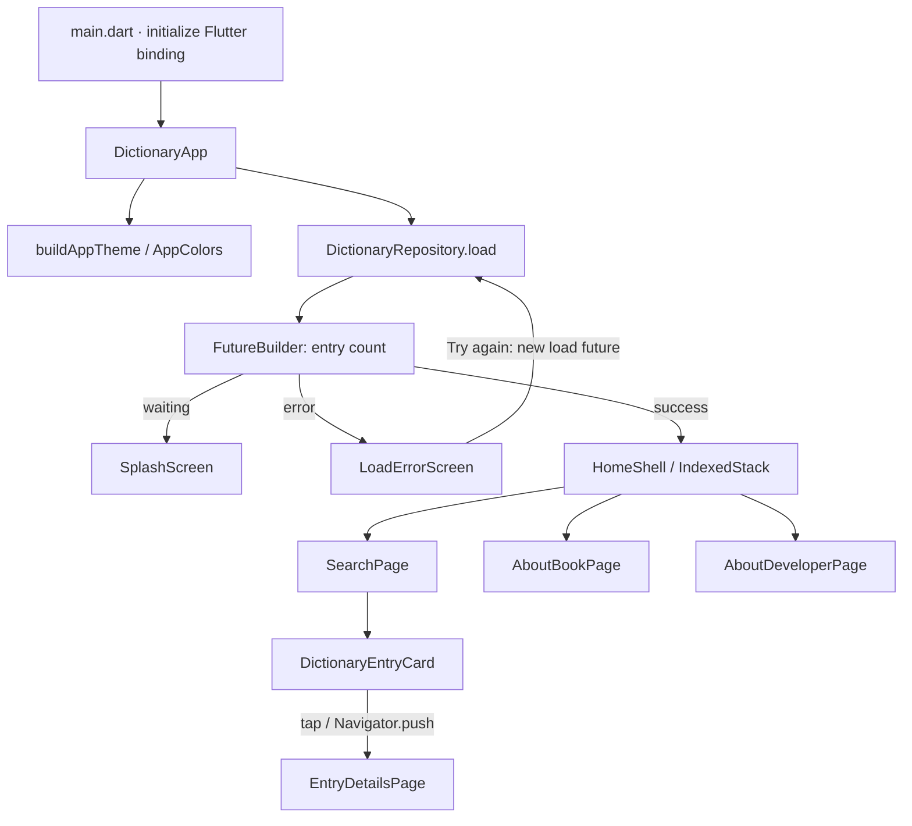
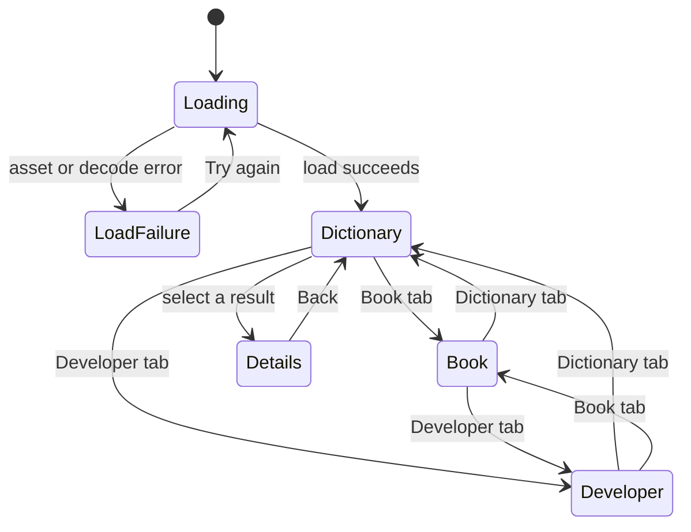
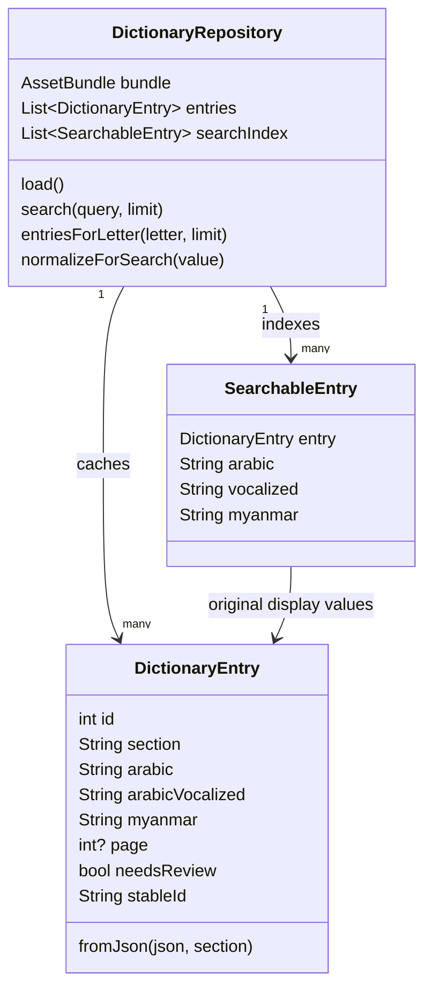
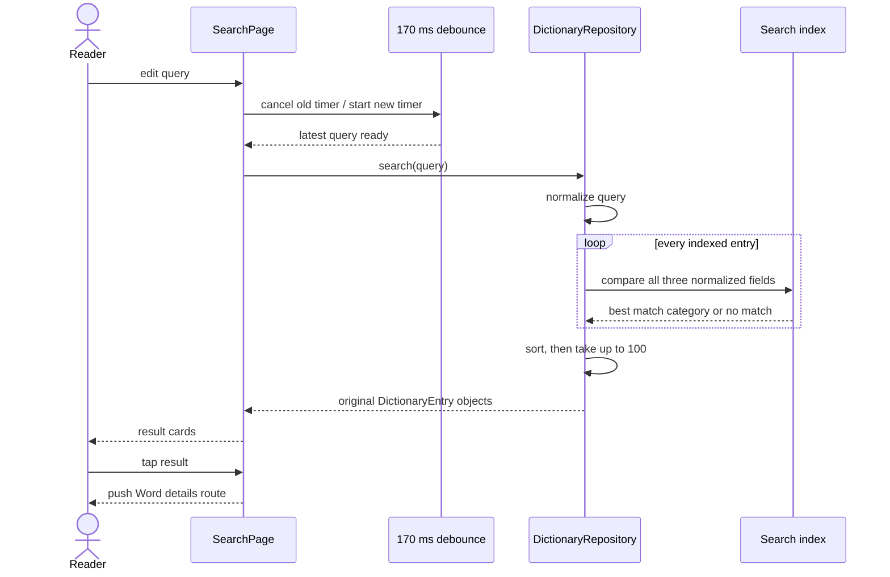
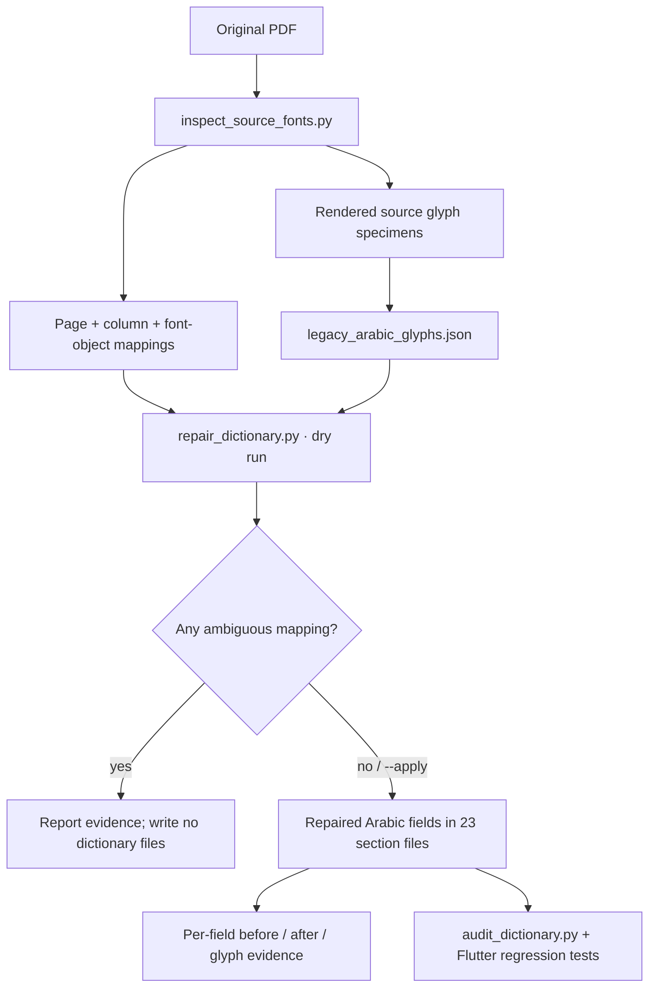

# Nur Arabic–Myanmar Dictionary: architecture and maintenance guide

Snapshot: 10 September 2026. App version: `1.0.1+2`. This document describes the
code and bundled data in this repository, including the Arabic encoding repair.
It does not describe a proposed backend or an unimplemented feature.

## Reading guide

- [System and deployment](#system-and-deployment)
- [Startup and component architecture](#startup-and-component-architecture)
- [Screens and navigation](#screens-and-navigation)
- [Data model and provenance](#data-model-and-provenance)
- [Search behavior](#search-behavior)
- [State and lifecycle](#state-and-lifecycle)
- [Text, accessibility, and visual design](#text-accessibility-and-visual-design)
- [Data integrity and the encoding repair](#data-integrity-and-the-encoding-repair)
- [Build, test, and release](#build-test-and-release)
- [Maintenance recipes](#maintenance-recipes)
- [Known limitations](#known-limitations)
- [Source map](#source-map)

Related deliverables: [data-quality report](DATA_QUALITY.md),
[logo design](../assets/logo_options/README.md).
The JSON [audit](data/entry-audit.json) contains the complete review queue; the
[correction ledger](data/character-corrections.json) contains every repaired field.

## System and deployment

Nur is a single-process Flutter application. It searches an in-memory index built
from 28 JSON assets, containing 17,020 extracted records. There is no application
server, database engine, authentication, network client, analytics integration,
or account system in the current Dart code. Updates to dictionary data require
rebuilding and distributing the app.



The original PDF is development evidence, not a runtime dependency. Neither the
PDF nor its embedded legacy fonts is bundled in `pubspec.yaml`. Python and PDF
inspection utilities are also development tools only.

| Target | Runner | Identity / configuration | Status established here |
| --- | --- | --- | --- |
| Android | Kotlin activity and Gradle | `com.nur.arabicmyanmardictionary`; Java 17; AGP 8.11.1; Kotlin 2.2.20 | Runner and existing APK/AAB are present |
| iOS | Swift app and scene delegates | Same bundle ID; deployment target 13.0 in Xcode project | Runner present; iOS execution requires macOS/Xcode |
| Linux | C++ GTK runner and CMake | Same application ID; executable `arabic_myanmar_dictionary`; initial window 1280 × 720 | Runner and an earlier local build are present |
| Web, Windows, macOS | No runner directories | Not configured in this repository | Do not infer support from Flutter's general capabilities |

Android compile, minimum, and target SDK values come from the selected Flutter
SDK through `flutter.*SdkVersion`, rather than fixed values in this repository.
The main Android manifest contains no `INTERNET` permission. Debug/profile
manifests enable development tooling; their permissions must not be confused
with the release manifest.

## Startup and component architecture

`main()` initializes the Flutter binding and runs `DictionaryApp`. That stateful
widget owns one repository and one load future. It creates the Material app,
global theme, and a `FutureBuilder` that selects the splash, error, or home screen.
The repository is injectable for tests.



Layers are small and explicit:

| Layer | Responsibility | Dependencies |
| --- | --- | --- |
| Configuration | App name, descriptions, author/developer profile and contact strings | Plain Dart |
| Model | Immutable entry fields, parsing defaults, combined review status | Plain Dart |
| Repository | Asset loading, JSON decoding, immutable cache, normalization and ranking | Flutter `AssetBundle`, model |
| Screens | Input, selected tab/query/letter, loading and navigation | Repository, model, shared widgets |
| Widgets and theme | Cards, information panels, geometric background, colors, typography | Flutter Material and drawing APIs |
| Platform runners | Native window/activity lifecycle and Flutter engine hosting | Flutter-generated platform integration |

There is no provider, BLoC, Redux, service locator, router package, database
adapter, or third-party runtime package in the pubspec. Flutter itself is the
only direct runtime dependency. `flutter_test` and `flutter_lints` are development
dependencies; transitive SDK packages are captured in `pubspec.lock`.

## Screens and navigation

The bottom bar switches among Dictionary, Book, and Developer. `IndexedStack`
keeps the three child states mounted while a different tab is visible. Search
also uses `AutomaticKeepAliveClientMixin`. Opening a result pushes a separate
Material route above the shell; backing out returns to the existing search.



| Screen | Visible content | Interaction and behavior |
| --- | --- | --- |
| Splash | Name, Myanmar motto, Language Bridge logo, progress indicator, dark pattern | Waits for the repository; no artificial timer |
| Load error | Error heading, exception text, retry button | Retries loading with the same repository |
| Dictionary idle | Header, search field, 28 letter chips, offline-use hint | Search either language or choose a starting letter |
| Dictionary results | Query/letter heading, result count, lazy result cards | Clear resets idle state; tap opens details |
| No results | Empty-state message | Suggests shorter queries or Arabic without vowel marks |
| Word details | Vocalized Arabic, optional plain Arabic, selectable Myanmar, section/page | Extraction warning appears when the model's review flag is true |
| Book | Description, language/entry/offline stats, features, author profile | Content and author placeholders come from configuration |
| Developer | Profile, skills, technologies, experience, available contacts | Nonempty contacts are copied to the OS clipboard; empty contacts show configuration guidance |

Letter browsing is a prefix filter over `entry.arabic`, not a filter over the
JSON section field. Consequently an entry placed under a root's book section can
appear under a different first-letter chip. The UI says “Words beginning with”.
Entries beginning with the definite article are filtered by their displayed
first letter; the article is not stripped.

## Data model and provenance

All 28 sections are explicitly named in two places:
`pubspec.yaml` packages the files; `DictionaryRepository.sectionFiles` loads them.
Their order establishes the concatenation order. The duplicate Dal file ending
`(1).json` and the older, unvocalized Alif file are retained as historical source
files but excluded from the app.

Each section includes `dictionary`, `section`, `source`, source-page information,
`entry_count`, `format_version`, extraction notes, quality counts, and `entries`.
Only the section label and entries are consumed by the runtime repository.

| JSON field | Runtime field | Parsing behavior |
| --- | --- | --- |
| `id` | `id: int` | Missing/null defaults to 0; IDs are only unique within a section |
| Section document's `section` | `section: String` | Missing section defaults to the empty string in the repository |
| `arabic` | `arabic: String` | Trimmed; missing/null becomes empty |
| `arabic_vocalized` | `arabicVocalized: String` | Trimmed; falls back to `arabic` when empty |
| `myanmar` | `myanmar: String` | Trimmed; missing/null becomes empty |
| `page` | `page: int?` | Optional source page |
| `needs_review`, `harakat_needs_review` | `needsReview: bool` | Logical OR of the two source flags |
| `arabic_source`, `column` | Not retained in the runtime model | Remain in JSON for provenance and source comparison |

`stableId` is `'$section-$id'`. It is an identity helper, not a database key or a
persisted favorite. Changing section labels changes stable IDs. Parsing is
permissive for missing fields but uses casts for types: a string where an integer
is required can still throw and trigger the load-error screen.



`load()` requests the 28 strings concurrently with `Future.wait`, decodes each
JSON document, builds the model list and three normalized strings per entry, and
stores both lists as unmodifiable. A later successful `load()` returns the
cached list. It does not currently cache an in-flight future; simultaneous first
calls can duplicate work. The app's normal startup initiates one load.

## Search behavior

Search normalizes the query and the plain Arabic, vocalized Arabic, and Myanmar
fields with the same function. Display text remains the source/repaired text;
search normalization does not overwrite it.

Normalization, in code order:

1. Lowercase.
2. Remove Arabic marks in U+064B–U+065F, U+0670 and U+06D6–U+06ED.
3. Remove tatweel U+0640.
4. Fold أ, إ, آ, ٱ to ا; ى to ي; ؤ to و; ئ to ي.
5. Collapse whitespace and trim.

This supports Arabic search with or without harakat, but it is not stemming,
root extraction, transliteration, typo correction, or full Unicode canonical
normalization. Myanmar strings retain their script characters. Myanmar input
must match the stored Unicode sequence; there is no Zawgyi keyboard converter.



| Score | Condition on any field | Priority |
| --- | --- | --- |
| 0 | Field equals query | Highest |
| 1 | Field begins with query | Next |
| 2 | A word begins with query | Next |
| 3 | Field contains query | Lowest matching category |
| No score | No field matches | Omitted |

Words are split on whitespace and `، ؛ , . ( ) - – —`. Equal scores are ordered
by the UTF-16 length of the original plain Arabic string. There is no explicit
tie-breaker after length, so equal-score/equal-length ordering is not promised.
There is no Arabic locale collation. Blank queries and queries containing only
removed marks return no results. Calling search before load returns no results.

Search returns up to 100 entries by default; browsing returns up to 120. There is
no pagination. The UI appends `+` when the returned count equals either limit;
this indicates a possible cap, not a computed total. Search scans every entry
and sorts matches: approximately O(N × field length + M log M) per query, with N
entries and M matches. The stored index avoids repeating most normalization;
word-prefix checks still allocate split strings. Loading, decoding, indexing and
search run on the main Dart isolate. No performance benchmark is claimed here.

## State and lifecycle

| Owner | State | Lifetime |
| --- | --- | --- |
| `DictionaryApp` | Repository and load future | App widget state |
| `DictionaryRepository` | Entries and normalized index | Repository instance |
| `HomeShell` | Selected tab index | Shell state |
| `SearchPage` | Controller, focus node, debounce timer, active query, selected letter, results | Mounted search tab |
| `EntryDetailsPage` | One immutable entry passed in its constructor | Pushed route |

The search timer is cancelled when typing again, choosing a letter, clearing,
or disposing the page. The callback checks `mounted`. Disposal releases the
controller and focus node. Choosing a letter clears and unfocuses the search
field. Clearing removes the selected letter and results. Query/selection state
is retained while tabs remain mounted but is not persisted across process exit.
There is no stored history, favorites list, settings store, or remote sync.

## Text, accessibility, and visual design

The Material app uses a light Material 3 theme. Its current design tokens are:

| Token | Value | Main use |
| --- | --- | --- |
| Navy | `#0C2D82` | Headers, Arabic headwords, primary controls |
| Royal blue | `#204DB5` | Secondary text, outlines, pattern |
| Sky blue | `#3998D8` | Illustrations and accents |
| Gold | `#C9B260` | Decorative borders, dividers, icons |
| Ivory | `#F8FAFF` | Scaffold background |
| Ink | `#10214F` | Main text |

Cards use rounded corners and subtle borders. `PatternBackground` combines a
gradient with `IslamicPatternPainter`, which draws offset grids of outlined
16-vertex stars and circles. It repaints when its color changes. `GoldDivider`
combines lines and a diamond icon. About pages share `InfoPageHero`, `InfoCard`,
and `FeatureTile`.

Arabic headwords in result cards and details explicitly use right-to-left text
direction. The search field uses RTL if its current text contains a character in
U+0600–U+06FF, otherwise LTR; this direction is rebuilt with the debounced state.
Mixed-language labels and the bilingual hero are ordinary combined strings.
The UI is primarily English; it does not define Flutter localization delegates.

No Arabic or Myanmar font is bundled. Rendering uses the platform's available
font fallback and shaping. This can vary between Android, iOS and Linux. A font
change cannot repair a Latin code point stored in a dictionary word: this repair
therefore changes the data itself.

Myanmar in the details screen is selectable. Result definitions are limited to
three lines and ellipsized; details provide the fuller text. Standard Material
widgets supply baseline interaction semantics. There is no recorded screen
reader, contrast, large-text, or cross-device glyph-shaping certification.
Gold is predominantly decorative; actual contrast should be checked before
using it for small text on a light background.

The logo concepts live in `assets/logo_options/`. The selected design is
**Language Bridge**. Its opaque navy master is
`assets/branding/nur-language-bridge.png`, bundled through the pubspec. The shared
`AppLogo` widget displays it at 128 logical pixels on the Flutter splash and 56
on the search header, with rounded corners and decorative image semantics.
Five Android launcher densities and all 15 unique iOS AppIcon PNGs are resized
from the same master. The iOS files are opaque RGB. No network service is needed
to display the logo.

## Data integrity and the encoding repair

The source book uses custom font encodings. Some glyphs combine two or more
Arabic letters into one drawn shape. The prior extraction left Latin fallback
codes in later sections and `⟦gNNNN⟧` placeholders in earlier sections. These
became part of both the displayed words and the normalized search index.

The repair reads source PDF font dictionaries, decodes named Unicode ligatures,
and transcribes the remaining unnamed glyphs from rendered source-font
specimens. Crucially, mappings use the page and column where the glyph was
actually drawn. PDF subsets can reuse both character codes and font names;
inspection therefore tracks font object IDs as well.



Result: 412 entries, 824 fields repaired. All 17,020 records remain, in their
original sections and order. IDs, pages, column information, Myanmar meanings,
`arabic_source`, and existing review flags are retained. Both runtime Arabic
fields have zero Latin letters and zero unresolved glyph-code placeholders.
The app does not delete characters or filter corrupted words at runtime.

This is an encoding repair, not certification of every translation or vowel.
The audit still lists 1,573 unique records for linguistic/source review, with
overlapping categories: 1,112 original review flags, 493 entries containing
legacy Latin characters in Myanmar, 604 entries containing legacy Arabic mark
codes, three missing Arabic headwords, and ten missing Myanmar meanings.
Some blanks are continuation rows from the extraction. The model's fallback for
one empty vocalized field is intentional. See [DATA_QUALITY.md](DATA_QUALITY.md)
for interpretation and source-review boundaries.

## Build, test, and release

The installed SDK used for verification is Flutter 3.41.9 / Dart 3.11.5.
Although `pubspec.yaml` declares Dart `>=3.3.0 <4.0.0`, the UI uses newer Flutter
APIs such as `CardThemeData` and `Color.withValues`. The Dart lower bound alone
is not proof that an older Flutter SDK can compile this project.

Typical development commands, from the repository root:

```sh
flutter pub get
python3 tool/audit_dictionary.py
flutter test
flutter analyze
flutter run -d linux
# Or choose a connected mobile device with flutter devices / flutter run.
```

Tests cover search normalization, model fallback, loading all assets, bilingual
queries, tab navigation, repaired words, complete Arabic-field integrity, and
the per-field correction ledger. The repeatable audit additionally compares
asset manifests, counts, IDs, and source-review categories. `--strict` is an
editorial release gate: it fails while the documented review queue is nonempty.
Passing ordinary tests must not be described as passing that stricter gate.

Android release workflow:

```sh
flutter build apk --release
flutter build appbundle --release
# Verify signing and test the result on a device before distribution.
```

Gradle reads the release key and password from ignored `.signing/` files. When
they are available it uses alias `nur-release`. The current Gradle script falls
back to debug signing when the release credentials are absent. A successful
build alone therefore does not establish production signing. Keep the signing
identity consistent for updates, keep credentials outside version control, and
verify the signing certificate before distributing a release.

The existing top-level `v1.0.0` APK/AAB and checksum files predate this repair.
Version `1.0.1+2` packages the repaired data and selected Language Bridge logo;
see [release verification](RELEASE_1.0.1.md) for the artifact checks. Build outputs
and signing material are ignored by Git. No app-store publication is performed.
An iOS release requires the Xcode project, signing
team/provisioning setup, and a macOS build environment. Linux distribution uses
the complete generated bundle, including its `data/` and `lib/` directories.

## Maintenance recipes

### Correct a dictionary entry

1. Identify its section, ID, source page and column. Preserve its original source
   text. Inspect the printed/source PDF row, including continuation lines.
2. Correct both `arabic` and `arabic_vocalized` where relevant. Never apply an
   ASCII-to-Arabic substitution globally: mappings vary by page and font subset.
3. Record evidence in the correction ledger or a subsequent reviewed ledger.
   Retain review flags until the associated language/diacritics concern is
   resolved; decoding an encoding defect is not sufficient evidence to clear it.
4. Regenerate the audit, run tests, and check both Arabic and Myanmar searches.
   A later intentional change to a recorded field must update its provenance
   and corresponding ledger assertion together.

### Regenerate source encoding evidence

```sh
python3 tool/inspect_source_fonts.py --source-pdf /path/to/AMDText.pdf --out /tmp/nur-source-evidence
python3 tool/repair_dictionary.py --source-map /tmp/nur-source-evidence/source-font-mappings.json --report /tmp/proposed-corrections.json
# Inspect the proposed report and glyph specimens before using --apply.
python3 tool/audit_dictionary.py --report docs/data/entry-audit.json
```

`inspect_source_fonts.py` uses `pdfminer.six`; the audit and repair scripts use
Python's standard library. The original PDF is not included in the repository.
On already repaired data, a new dry run should propose zero field changes.
Use a new report path when rerunning repair so the original historical ledger
is preserved.

### Add or replace a section

Update both the pubspec and repository file list in matching order. Validate
JSON types and section-local IDs, update `entry_count`, adjust intentional test
totals, and check source-page metadata and review information. The current
alphabet chips are a fixed list of 28 letters and do not derive from the files.
Changing a file list alone does not change that UI.

### Personalize the about pages

Edit `lib/src/config/app_content.dart`: app/book names and descriptions, author
biography, developer identity, experience, skills and contacts. Empty contact
strings are not actionable links. Contacts copy their text; adding a website
value does not cause the app to open a browser automatically.

### Update the app logo

The selected Language Bridge master is in `assets/branding/`. Replace that master
deliberately, then resize it to
the five Android mipmap sizes (48, 72, 96, 144 and 192 pixels) and the sizes listed
in the iOS AppIcon `Contents.json`. Keep iOS launcher files opaque and preserve
the master artwork's margins. `AppLogo` already connects the pubspec asset to
the splash and search header. Inspect both in-app and launcher rendering after
a change, and retain the unused concepts for reference.

## Known limitations

- The listed linguistic review queue prevents a claim that all vocabulary,
  translations, vowel placement and legacy mark positions are flawless.
- Three source records have no Arabic text, and ten have no Myanmar definition;
  the current UI can show their empty fields. They need row-level editorial
  work, not invented text.
- Search and indexing run on the UI isolate; result limits have no pagination.
  There is no measured slow-device startup or search latency budget.
- No bundled fonts, full app localization, persistent preferences, favorites,
  audio, morphology, or online updates are implemented.
- Author and developer details remain placeholders. UI accessibility and mobile
  release behavior still need device testing.
- The original extraction pipeline is not in this repository. The new tools
  recover identified encoding artifacts; they do not re-create the entire
  original PDF-to-Myanmar conversion or its row matching.
- There is no repository CI workflow. Local checks do not run automatically on
  a remote push unless CI is added separately.

## Source map

| File / directory | Responsibility |
| --- | --- |
| `lib/main.dart` | Flutter entry point |
| `lib/src/app.dart` | MaterialApp, repository ownership, splash and retry |
| `lib/src/config/app_content.dart` | Editable identity and about-page content |
| `lib/src/models/dictionary_entry.dart` | Entry parser and immutable model |
| `lib/src/services/dictionary_repository.dart` | Asset list, cache, index, normalization, ranking |
| `lib/src/screens/home_shell.dart` | Bottom navigation and mounted tab stack |
| `lib/src/screens/search_page.dart` | Search input, debounce, alphabet, results, detail navigation |
| `lib/src/screens/entry_details_page.dart` | Full entry and extraction warning |
| `lib/src/screens/about_book_page.dart` | Book and author information |
| `lib/src/screens/about_developer_page.dart` | Developer profile and clipboard action |
| `lib/src/widgets/dictionary_entry_card.dart` | Arabic/ Myanmar result card |
| `lib/src/widgets/app_logo.dart` | Shared selected logo for splash and search header |
| `lib/src/widgets/info_page_widgets.dart` | Shared information-page components |
| `lib/src/widgets/islamic_pattern.dart` | Background painter and gold divider |
| `lib/src/theme/app_theme.dart` | Theme, colors and widget styling |
| `android/`, `ios/`, `linux/` | Platform lifecycle and build configuration |
| `test/` | Widget, repository and corpus-regression tests |
| `tool/` | Audit, source inspection, reviewed glyph map and repair utility |
| `docs/data/` | Complete audit/review inventory and correction provenance |
| `assets/logo_options/` | Logo concepts |
| `assets/branding/` | Selected Language Bridge master |
| `assets/profile/` | Developer portrait used on the About Developer page |
| `assets/source_pages/` | Reference images of dictionary pages; not bundled in the app |
